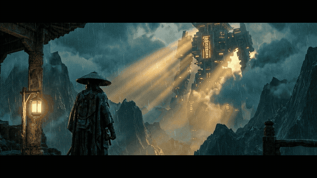

# 🎬 精准电影镜头提示词系统 (Cinematic Shot Prompting)

> **将叙事意图与分镜剧本编译成可工业级执行的电影镜头运动提示词。**  
> 专为 **可灵 (Kling) / 即梦 (Dreamina) / Runway Gen-3 / Sora / Luma** 等主流 AI 视频生成模型打造的镜头运动语法与六维质检标准体系（Skill）。

[](LICENSE)
[](SKILL.md)
[](#-支持的-ai-视频模型)
[](https://github.com/287523023qq-hue/cinematic-shot-prompting)

<div align="center">
  
  <p align="center">
    <strong>⚡ 电影级六维运镜控制成片演示 (Push-in + Orbit + Dolly Zoom)</strong><br>
    <em>彻底解决 AI 视频“镜头乱晃、背景变形、主体丢失、速度突变”的核心痛点</em>
  </p>
</div>

---

## 🌟 核心价值：为什么需要本系统？

在 AI 视频生成中，直接输入“镜头很酷地推近”90% 会翻车：
- ❌ **翻车表现**：主体突然多出肢体、背景如水流般变形、镜头忽快忽慢、画面产生果冻效应。
- ✅ **本系统解法**：建立**「运镜六维质检标准」**，强制在编译提示词时锚定六大物理与摄影学约束：

```
[1. 起点机位] ──> [2. 动力机制] ──> [3. 路径与阻尼] ──> [4. 主体锁定] ──> [5. 环境视差响应] ──> [6. 终点落点帧]
```

---

## 📐 运镜语法六维质检体系 (6-Dimension Quality Check)

| 维度 (Dimension) | 必须明确的技术要素 | 常见缺失导致的翻车 |
| :--- | :--- | :--- |
| **1. 起点 (Origin)** | 明确起始景别（大远景/中景/特写）与初始机位角度（平视/俯拍/仰拍） | AI 自行脑补乱给起始画面 |
| **2. 机制 (Mechanism)** | 运镜物理承载：手持（Handheld）、轨道推拉（Dolly）、机械臂（Technocrane）、车载（Tracking） | 机械突变或超现实悬浮漂移 |
| **3. 路径与速度 (Path & Speed)** | 运动轨迹（直线/圆弧/复合）与加速度曲线（匀速/缓慢加速/平缓阻尼停止） | 镜头抽搐或运动过快导致糊片 |
| **4. 主体锁定 (Subject Lock)** | 构图锚点（锁定头部/胸部/眼部）与允许的景别变化区间 | 运动中主体移出画幅或换脸 |
| **5. 环境响应 (Environment Response)** | 前景遮挡物视差、环境粒子（雨雪/光束）反向位移、景深虚化演变 | 背景平面化、缺乏真实三维景深 |
| **6. 落点 (Termination)** | 镜头结束时的终极构图与视觉停留点，为下个分镜预留剪辑点 | 视频在半空中突兀切断 |

---

## 📚 镜头词典与模式库 (Shot Patterns)

本项目内置详尽的镜头模式对照库，详见 [`references/shot-patterns.md`](references/shot-patterns.md)：

- 🔭 **推镜头 (Push-in / Dolly In)**：情绪递进、秘密揭示、心理压迫感
- 🎬 **拉镜头 (Pull-back / Dolly Out)**：孤独感塑造、环境交代、世界观展开
- 🔄 **环绕跟拍 (360° Orbit / Arc Shot)**：角色高光时刻、时间凝固感、空间全景交代
- ⚡ **希区柯克变焦 (Vertigo / Dolly Zoom)**：空间扭曲、顿悟、精神震颤
- 🦅 **低空俯冲 (Low-altitude Dive & Fly-through)**：穿过门廊、穿越树林的高速沉浸感
- 🌫️ **移轴与焦点转换 (Rack Focus)**：视线焦点在前景与背景间的丝滑转移

---

## ⚡ 1 分钟极速上手 (Quick Start)

### 安装至 AI Coding & Prompting Agent
只需克隆本仓库到您的技能目录：

```bash
# Antigravity 用户
cp -R cinematic-shot-prompting ~/.gemini/config/skills/

# Codex 用户
cp -R cinematic-shot-prompting ~/.codex/skills/
```

### 提示词调用范例 (自然语言直接对话)

> 💬 **用户提问**：  
> *“帮我设计一个镜头：赛博朋克雨夜街道，主角站在霓虹招牌下点烟，镜头从远处地面快速穿过积水，贴地滑行并向上仰拍到主角点烟的面部特写，时长 5 秒。”*

> 🤖 **系统编译输出**：  
> ```text
> [Camera Movement]: Ultra-low-angle dolly shot starting 2 inches above the wet asphalt, gliding forward at a swift uniform speed through neon-reflecting puddles.
> [Focal Transition]: Smooth tilt-up as the camera nears the protagonist, transitioning from an extreme wide ground-level perspective into a low-angle dramatic close-up.
> [Subject Framing]: Locks onto the protagonist's weathered face and mechanical hand striking a vintage brass lighter.
> [Environmental Parallax]: Dynamic water droplets splashing towards the lens; neon billboards in the background shift naturally with depth-of-field blur.
> [Termination]: Settles firmly on a tight low-angle profile shot, the sudden flare of the flame illuminating his intense amber cybernetic eyes, shallow depth of field, f/1.8, 24fps cinematic motion blur.
> ```

---

## 🛠️ 目录结构 (Repository Structure)

```bash
cinematic-shot-prompting/
├── SKILL.md                   # 智能体核心行为规范与执行指令
├── README.md                  # 项目全景说明
├── LICENSE                    # MIT 开源协议
├── references/                # 核心工业参考库
│   ├── prompt-grammar.md      # 标准运镜提示词语法
│   ├── shot-patterns.md       # 经典电影镜头库与中英对照
│   ├── shot-selection.md      # 导演级分镜决策思维导图
│   └── repair-guide.md        # 画面变形与乱晃急救手册
├── tests/                     # 验证测试用例
│   └── test-prompts.json      # 100+ 场景提示词测试集
└── docs/                      # 深度理论与演进白皮书
    ├── BOOK_OVERVIEW.md       # 影视摄影理论全局概览
    ├── GLOSSARY.md            # 专业影视摄影术语中英表
    └── candidates/            # 进阶构图与镜头动力学案例
```

---

## 📄 开源许可证

本项目采用 [MIT 许可证](LICENSE)。欢迎个人学习、商业视频创作与开源社区二次开发。
